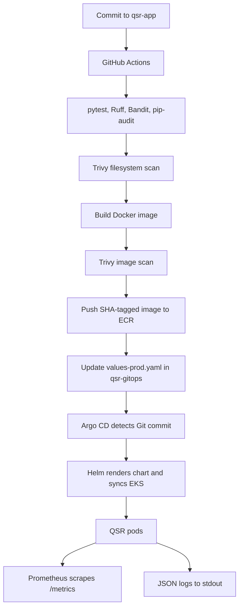

# QSR Architecture — Helm-based GitOps

## Components
- **QSR Orders API:** Python Flask API, tests, JSON logs, Prometheus metrics.
- **GitHub Actions:** tests, static analysis, Python security lint, dependency SCA, filesystem scan, Docker build/image scan, ECR push, GitOps Helm values update.
- **Amazon ECR:** image registry using commit-SHA tags and scan-on-push.
- **Amazon EKS:** runs the Helm-managed Deployment and Service with probes, resource controls, security context, rolling updates, and PDB.
- **Argo CD:** watches GitOps Git state and deploys the Helm chart. It does not watch ECR.
- **Prometheus/Grafana:** Prometheus Operator scrapes the app ServiceMonitor; Grafana visualizes metrics.
- **Logs:** app writes structured JSON logs to stdout/stderr. Configure CloudWatch Observability/Fluent Bit or Grafana Alloy + Loki for centralized search and retention.

## CI/CD sequence

## Repositories
- `qsr-app`: source, tests, Dockerfile, workflow. CI does not use kubectl to deploy.
- `qsr-gitops`: Helm chart and environment values are the desired state. CI changes only the image repository/tag; Argo CD performs deployment.

## Metrics
- `qsr_http_requests_total` — request count by method, route, status.
- `qsr_http_request_duration_seconds` — latency histogram.
- `qsr_orders_created_total` — accepted demo orders.
- Default Python/process metrics from `prometheus_client`.

The ServiceMonitor assumes Prometheus Operator and label `release: kube-prometheus-stack`; adjust if the Helm release name differs.

## Security choices and limits
GitHub OIDC (no long-lived AWS keys), least-privilege ECR push role, immutable image tags, ECR scan-on-push, Trivy gates, non-root container, read-only root filesystem, dropped Linux capabilities, probes, requests/limits, and restricted EKS API CIDRs are included. This is a reference baseline, not a complete enterprise landing zone. Review action pins, scanner findings, secrets, retention, backups, and availability before production. The sample stores orders in memory and has no public ingress.
